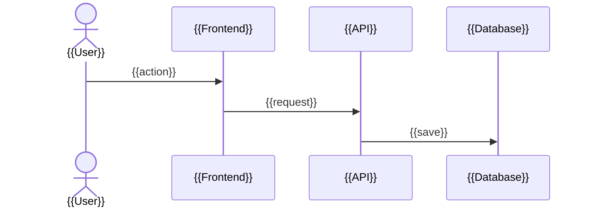

# {{Project Name}} — Project Overview

> **Generated:** {{YYYY-MM-DD}} · **Last updated:** {{YYYY-MM-DD}}
> **Scope:** {{whole repository / folders covered}} · **Excluded:** {{...}}

<!--
TEMPLATE INSTRUCTIONS
- Action 3: runs after FILE_DESCRIPTIONS.md and DATABASE_OVERVIEW.md are written or updated in the same run.
- Summarize them; link to their detail instead of repeating it.
- Flow step numbers follow "Core flow step numbers" in 00_GENERATION_RULES.md.
- Follow 00_GENERATION_RULES.md and 01_LANGUAGE_GUIDE.md.
- HTML comments are guidance. Remove them from the final document.
-->

## At a Glance

<!-- Three to five sentences: what the app does, who uses it and for what problem, and its status (prototype, production, maintenance). A stakeholder reading only this should understand the app. -->

{{...}}

## Glossary

<!-- Terms that would confuse a newcomer, including code names that differ from business names (`Client` in code means "customer"). One line each, alphabetical. All three documents use these names. -->

| Term | Meaning |
|---|---|
| {{Term}} | {{One-line definition}} |

## Tech Stack

<!-- Languages, frameworks, database, hosting, key libraries (skip small utilities), and third-party services (payments, email, auth, AI APIs) with what each is used for. -->

| Part | Technology | Used for |
|---|---|---|
| {{Backend}} | {{...}} | {{...}} |
| {{Database}} | {{...}} | {{...}} |
| {{External service}} | {{...}} | {{...}} |

## High-Level Architecture

<!--
The main parts (web page, API, worker, database, external services), what each does, how they talk (requests, queues, webhooks, schedules), and what runs where.
One plain paragraph, then the diagram, then one line per part.
-->

{{Plain-language paragraph.}}

```mermaid
flowchart LR
    {{User}} --> {{Frontend}} --> {{API}} --> {{Database}}
```

- **{{Part}}:** {{What it does. Link to the main folder in FILE_DESCRIPTIONS.md.}}

## Core Data Flow

<!--
What starts the main flow (user action, schedule, webhook), each step to the final result, and what the user or business gets.
Per step: the part of the app, the file or function, and the tables read or written. Main successful path only.
-->

{{One or two sentences on what the flow achieves.}}



<a id="flow-step-1"></a>
**1. {{Step name}}**
{{What happens, in one or two sentences.}}
*Code:* [`{{function()}}`](FILE_DESCRIPTIONS.md#file-{{anchor}}) · *Data:* [`{{table}}`](DATABASE_OVERVIEW.md#table-{{table}}) ({{created / read / updated}})

<a id="flow-step-2"></a>
**2. {{Step name}}**
{{...}}

**Result:** {{What the user or business has at the end.}}

## Phases

<!--
Phases, goals and current phase come from `docs/project-phase-plan.md` (link it). Each phase: one business and one technical sentence.
For the current phase, judge what's done from the code; the plan doesn't track progress. Don't invent a roadmap.
-->

{{One or two sentences on how the work is split into phases, and which phase is current.}}

| Phase | Delivers (business) | Delivers (technical) | Status |
|---|---|---|---|
| {{1 — Name}} | {{...}} | {{...}} | {{Done / In progress / Not started}} |

**Current phase:** {{What is done, what is still to build. Link finished parts to FILE_DESCRIPTIONS.md.}}

## Repository Structure

<!-- Top-level folders (one level deeper where it helps) and where a new developer should start. Link to FILE_DESCRIPTIONS.md for detail. -->

```
{{project-root}}/
├── {{src/}}        {{What lives here}}
├── {{migrations/}} {{What lives here}}
└── {{tests/}}      {{What lives here}}
```

**Start reading here:** {{file or folder, and why}}

## Development Workflow

<!--
Exact numbered setup and run commands; tests, lint and format; branching and review; CI/CD and how code reaches production.
Only what the repository shows (README, scripts, CI config); mark anything else ⚠️ Needs confirmation.
-->

### Run Locally

1. {{...}}

### Tests and Code Checks

{{...}}

### Branches and Reviews

{{...}}

### Deployment

{{...}}

### Database Changes

<!-- If the project has no database, replace the line below with: "Not relevant at this point." -->

See [Migrations and Schema Changes](DATABASE_OVERVIEW.md#migrations-and-schema-changes).

## Logging, Monitoring and Errors

<!-- Where logs go and how to read them, how errors are reported, and what happens when an external service fails. -->

{{...}}

## Known Limitations and Technical Debt

<!-- What's fragile, incomplete or due for rework (from TODO/FIXME, open issues, obvious gaps). One plain fact per line, no blame. -->

- {{...}}

## Where to Go Next

- [File Descriptions](FILE_DESCRIPTIONS.md): what each file and function does.
- [Database Overview](DATABASE_OVERVIEW.md): tables, fields, and how they connect.

**Suggested reading order for a new developer:**

1. {{This document: At a Glance, Glossary, Core Data Flow}}
2. {{Database Overview: the main tables}}
3. {{File Descriptions: the files named in the Core Data Flow}}
