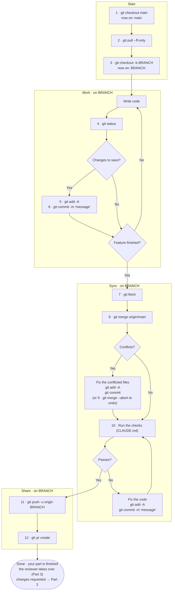
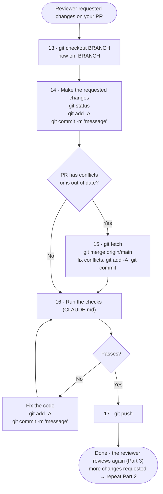
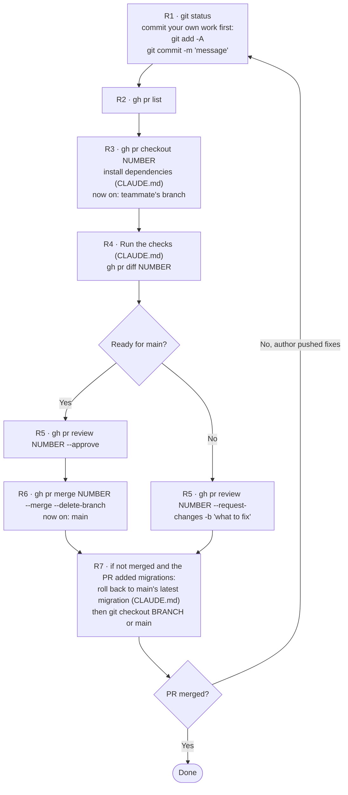

# Project Workflow

How our team builds features and gets them into `main`. Follow the steps in order, every time.

The idea: everyone works on their own branch, nobody changes `main` directly, and every change goes through a pull request that a teammate reviews and approves before it's merged.

This file has three processes:

- **[Part 1 · Working on a new feature](#part-1--working-on-a-new-feature)** (steps 1–12). Your part ends when you open the pull request.
- **[Part 2 · Making changes the reviewer requested](#part-2--making-changes-the-reviewer-requested)** (steps 13–17), only if the reviewer asks for changes.
- **[Part 3 · Reviewing a teammate's pull request](#part-3--reviewing-a-teammates-pull-request)** (steps R1–R7), when someone asks you to review their work.

For a plain-language summary of building a feature with the agent, see [Simplified process description](#simplified-process-description) at the end.

---

## Key terms

| Term | Meaning |
|---|---|
| **main** | The official version of the project the whole team builds on. Your computer has a local copy. |
| **origin/main** | Git's record of `main` on GitHub. Updated by `git fetch` or `git pull`. |
| **branch** | A separate working version for one feature. Your folder shows one branch at a time; switching changes the files to match. |
| **commit** | A saved snapshot of your changes, with a short description. |
| **GitHub** | Where the shared project is stored online. |
| **pull request (PR)** | A request on GitHub for the team to review your branch before it's merged into main. |
| **BRANCH** | Placeholder for your branch name, `NN-short-slug` as `CLAUDE.md` names it (e.g. `12-password-reset`), or `short-slug` without an issue. |
| **the checks** | The commands under *Checks* in `CLAUDE.md`, tests included (after applying migrations, if there's a database). Run them exactly as listed. |
| **NUMBER** | Placeholder for a PR's number, shown by `gh pr list`. |
| **OWNER/REPO** | Placeholder for the project's GitHub path, e.g. `my-org/my-app`. |

---

## Team rules

1. **Never commit or push directly to main.** All work happens on a branch.
   - One exception: the commit that adds the template and the `/setup` files, made before the project is on GitHub.
   - Documentation updates from `/professorslughorn` (design docs, `CLAUDE.md`, `claude-context/Project Overview/`) go through a PR like any other change.
2. **One branch per feature.** Your work is finished when you open its PR (step 12). After that, you only return to the branch if the reviewer requests changes (Part 2). Never reuse a branch for another feature; every new feature starts at step 1 with a new branch.
3. **Never force-push** (`git push --force` or `-f`).
4. **Every PR needs a teammate's approval** before it's merged.
5. **Always run the checks before pushing.** If it doesn't work on your machine, it doesn't go up.
6. **The reviewer merges the PR** right after approving it (step R6). The author doesn't start a new feature until their PR shows **Merged** on GitHub; until then, they only work on requested changes (Part 2). Each developer checks this themselves — the agent doesn't.
7. **When in doubt, run `git status`** and read it before doing anything else.

---

## One-time setup

**Each team member, on their computer:**

- [ ] Install Git and the GitHub CLI (`gh`)
- [ ] Log in to GitHub: `gh auth login`
- [ ] Download the project: `gh repo clone OWNER/REPO`, then `cd REPO`
- [ ] Check the connection: `git remote -v` should show `origin`
- [ ] Install the dependencies: the install command under *Commands* in `CLAUDE.md`
- [ ] Start local services and set up the database, if any: *Commands* and *Database migrations* in `CLAUDE.md`

**Once per repository, by whoever manages it on GitHub:**

- [ ] **Settings → General → Pull Requests:** turn on **Automatically delete head branches**, so merged branches are removed even when merged from the website
- [ ] Make sure `.gitignore` covers secrets (`.env`, keys), build output, dependencies and editor files

GitHub doesn't enforce rules 1, 4 and 6 here. The team follows them by agreement.

---

## Part 1 · Working on a new feature

### Overview



### Step by step

| # | Stage | Command | Branch (before → after) | What it does | Why |
|---|---|---|---|---|---|
| 1 | Start | `git checkout main` | any → **main** | Switches to main; your files change to match. Other branches stay saved. | Steps 2–3 work on the current branch. |
| 2 | Start | `git pull --ff-only` | main → main | Updates your local main from GitHub. | Your new branch then includes the team's latest work. If local main has commits GitHub doesn't, it stops instead of combining them (see [Troubleshooting](#troubleshooting)). |
| 3 | Start | `git checkout -b BRANCH` | main → **BRANCH** | Creates a branch from main and switches to it. | Keeps your work separate from main until it's reviewed. |
| 4 | Work | `git status` | BRANCH → BRANCH | Lists changed files and the current branch. | A safe check of where you stand, anytime. |
| 5 | Work | `git add -A` | BRANCH → BRANCH | Selects all changed, new and deleted files for the next commit. | Check the `git status` list first, so no passwords, keys or junk get in. |
| 6 | Work | `git commit -m "message"` | BRANCH → BRANCH | Saves the selected changes as a commit. | Records progress. Commit often, and always before switching branches. |
| 7 | Sync | `git fetch` | BRANCH → BRANCH | Updates origin/main from GitHub. Your files and local main don't change. | Step 8 merges from origin/main, so it must be current. |
| 8 | Sync | `git merge origin/main` | BRANCH → BRANCH | Adds GitHub's main into your branch. Local main isn't touched. | Your branch gets the team's latest work. Conflicts are fixed on your branch, then `git add -A` and `git commit`. If there's a database, run the single-head check from `CLAUDE.md`; two latest migrations are fixed as `/feature finalize` step 2 describes. |
| 9 | Sync *(only if needed)* | `git merge --abort` | BRANCH → BRANCH | Cancels the merge and restores your branch. | For a confusing conflict. Nothing is lost; try step 8 again. |
| 10 | Sync | *Run the checks* (`CLAUDE.md`) | BRANCH → BRANCH | Checks the project works with your changes and the team's. With the agent: `/feature test` runs the tests, `/feature finalize` the rest. If step 8 brought in new work, finalize stops so you rerun `/feature test` first. | Changes that work separately can break when combined. Don't continue until this passes. |
| 11 | Share | `git push -u origin BRANCH` | BRANCH → BRANCH | Uploads your branch. `-u` links it, so later a plain `git push` works. | The team can only review what's on GitHub. Main doesn't change. |
| 12 | Share | `gh pr create` | BRANCH → BRANCH | Opens a PR with a title and description. | Asks the team to review before it goes into main. Share the link. |

**With the agent**, the `/feature` actions run these steps for you:

| Action | Steps | What changes | Its checks |
|---|---|---|---|
| `/feature describe` | 1–2, then writes the spec | The spec | None |
| `/feature implement` | 2–6 | The feature's code | None; you try it by hand |
| `/feature test` | writes and runs tests, then 4–6 | Test files, plus bug fixes a test finds | **Tests** (the whole suite) — the only action that runs them |
| `/feature finalize` | 4–12, minus step 10's tests | Small fixes (formatting, style), plus the spec's Status line | **Format, lint, type checks** — everything except tests |

Steps 4–6 are "save your work", so every action from implement on repeats them (implement's first commit also carries describe's spec). Steps 7–12 happen once, in `/feature finalize`.

**Why finalize can send you back to `/feature test`:** if step 8 brings in a teammate's work, the tests you ran didn't include it. The same applies if a finalize fix changes what the code does, not just how it looks.

**Part 1 ends here.** Your work is done once the PR is open.

- **Reviewer requests changes:** follow [Part 2](#part-2--making-changes-the-reviewer-requested).
- **Reviewer approves and merges:** nothing to do on this branch. When the PR shows **Merged**, start your next feature at step 1; steps 1–2 bring in your merged PR. Optional: delete the old branch with `git branch -d BRANCH` while on main.

### Checkpoints

Don't move to the next stage until the checkpoint is true.

| After stage | Check |
|---|---|
| Start | `git status` says you're on BRANCH. |
| Work | `git status` says *nothing to commit, working tree clean*. |
| Sync | Merge finished, no conflicts left, tree clean, checks pass. |
| Share | The PR exists on GitHub and the team has the link. |

### Writing a good pull request

- **Title and description:** follow the PR format under *Workflow* in `CLAUDE.md`.
- **Keep it small.** One feature per PR. Small PRs get reviewed faster and conflict less.

---

## Part 2 · Making changes the reviewer requested

**Only if needed:** when the reviewer requests changes, or GitHub says your PR has conflicts. If the reviewer approves and merges, skip it.

### Overview



### Step by step

| # | Stage | Command | Branch (before → after) | What it does | Why |
|---|---|---|---|---|---|
| 13 | Return | `git checkout BRANCH` | any → **BRANCH** | Switches back to your feature branch. | Fixes belong on the PR's branch. Commit any other work first. |
| 14 | Fix | Make the changes, then `git status` + `git add -A` + `git commit -m "message"` | BRANCH → BRANCH | Saves the requested changes, like steps 4–6. | Only change what the reviewer asked for. |
| 15 | Sync *(only if GitHub says the PR has conflicts or is out of date)* | `git fetch` + `git merge origin/main` | BRANCH → BRANCH | Adds the team's latest main, like steps 7–9. | Fix conflicts on your branch, then `git add -A` and `git commit`. With a database, run the single-head check from `CLAUDE.md`, as in step 8. |
| 16 | Check | *Run the checks* (`CLAUDE.md`) | BRANCH → BRANCH | Checks the project still works. | Rule 5. |
| 17 | Share | `git push` | BRANCH → BRANCH | Uploads your fixes. | The PR updates automatically. Tell the reviewer it's ready. |

**Part 2 ends here.** The reviewer checks again (Part 3). If they request more changes, repeat Part 2.

---

## Part 3 · Reviewing a teammate's pull request

### Overview



### Step by step

| # | Stage | Command | Branch (before → after) | What it does | Why |
|---|---|---|---|---|---|
| R1 | Prepare | `git status`, then if needed `git add -A` + `git commit -m "message"` | yours → yours | Saves unfinished work on your branch. | The next steps switch branches. |
| R2 | Find | `gh pr list` | yours → yours | Shows open PRs and their numbers. | To find the PR number. |
| R3 | Get the code | `gh pr checkout NUMBER`, then the install command from `CLAUDE.md` | yours → **teammate's** | Switches to the PR's branch and installs packages it added. | Rerun when reviewing again after fixes. |
| R4 | Test | *Run the checks* (`CLAUDE.md`), and `gh pr diff NUMBER` | teammate's → same | Runs the checks and shows the changed lines. | It must build, work, and contain no secrets or junk. |
| R5 | Decide | `gh pr review NUMBER --approve` **or** `gh pr review NUMBER --request-changes -b "what to fix"` | teammate's → same | Approves, or asks for changes with your explanation. | Approval allows the merge; a change request blocks it. |
| R6 | Merge *(only if approved)* | `gh pr merge NUMBER --merge --delete-branch` | teammate's → **main** | Merges with a merge commit, deletes the branch everywhere, switches you to main. | Only after you approved and the checks pass (on GitHub too, if there's CI). |
| R7 | Return | If you didn't merge and the PR added migrations: roll back to main's latest migration with *Roll back to a specific migration* under *Database migrations* in `CLAUDE.md`. Then `git checkout BRANCH`, or stay on `main` | teammate's or main → **yours** or **main** | Undoes the PR's migrations locally, then returns you to your branch or main. | Your DB ran the PR's migration in R4; code without it may fail. Don't change your teammate's branch; comment on the PR instead. |

The author waits for this merge before starting their next feature, so merge promptly once you approve. They don't need to do anything after: their next Part 1, steps 1–2, pulls in the merged work.

### What to check in a review

- Do the checks in `CLAUDE.md` pass?
- Does the feature work when you try it?
- Is anything confusing? Ask on the PR.
- Any passwords, keys, `.env` files or build output in the changes?
- Does the PR do one thing, as its title says?

---

## Troubleshooting

| Problem | What it means | What to do |
|---|---|---|
| `git pull --ff-only` fails on main (step 2) | You committed on main by accident, so it doesn't match GitHub. | Commit everything. Then `git branch BRANCH` (saves your commits on a new branch), `git reset --hard origin/main` (resets main to GitHub's), `git checkout BRANCH`. Continue from step 4. |
| Merge conflict and you're lost (step 8) | The combined changes clash. | `git merge --abort`, then retry step 8. Ask the teammate who changed the file if unsure which version to keep. |
| `git push` rejected on your branch | GitHub has commits on your branch that you don't. | `git pull --no-rebase`, fix conflicts, `git push`. Never `--force`. |
| GitHub says the PR has conflicts or is out of date | main changed since your last sync. | Follow Part 2. |
| `gh pr checkout` or `git checkout` refuses to switch | Unsaved changes would be overwritten. | Commit first (steps 4–6), then retry. |
| `git branch -d` says "not fully merged" | Local main lacks the merged PR, or the branch has unpushed commits. | Run steps 1–2, then retry. If it still fails, confirm the PR shows **Merged** and `git log origin/main..BRANCH` shows nothing you need, then `git branch -D BRANCH`. |
| `gh: not logged in` | The GitHub CLI isn't connected. | `gh auth login` |
| Not sure which branch you're on | | `git branch --show-current` or `git status` |
| You committed a password or key | It's in the project's history. | Don't push. Tell the team, remove it, change it wherever it's used, and ask for help cleaning the history. If already pushed, change it immediately. |

---

## Cheat sheet

### Working on a new feature

```bash
# Start (steps 1–3)
git checkout main
git pull --ff-only
git checkout -b BRANCH

# Work (steps 4–6), repeat as you go
git status
git add -A
git commit -m "message"

# Sync with the team's latest work (steps 7–10)
git fetch
git merge origin/main
# fix conflicts if any, then: git add -A && git commit
# database only: run the single-head check from CLAUDE.md
# run the checks listed in CLAUDE.md

# Share (steps 11–12)
git push -u origin BRANCH
gh pr create

# Done: wait until the reviewer merges, then start the next feature at step 1.
# Optional, once you're on an updated main:
git branch -d BRANCH
```

### Making changes the reviewer requested (only if needed)

```bash
git checkout BRANCH         # 13: back to your feature branch
# 14: make the changes, then:
git status
git add -A
git commit -m "message"
# 15: only if GitHub says the PR has conflicts or is out of date:
git fetch
git merge origin/main
# fix conflicts if any, then: git add -A && git commit
# database only: run the single-head check from CLAUDE.md
# 16: run the checks listed in CLAUDE.md
git push                    # 17: the PR updates automatically
```

### Reviewing a teammate's pull request

```bash
git status                  # R1: commit your own work first if needed
gh pr list                  # R2: find the PR number
gh pr checkout NUMBER       # R3: get their branch, then run the install command from CLAUDE.md
gh pr diff NUMBER           # R4: see what changed, then run the checks in CLAUDE.md
gh pr review NUMBER --approve                                 # R5: approve
gh pr review NUMBER --request-changes -b "what to fix"        # R5: or ask for changes
gh pr merge NUMBER --merge --delete-branch                    # R6: merge, only if approved
# R7: only if not merged and the PR added migrations: roll back to main's latest migration (CLAUDE.md)
git checkout BRANCH         # R7: back to your own branch (or stay on main)
```

---

## Simplified process description

Building a feature with the agent, in plain language. Choose **VERBOSE** (default: the agent asks before every command, commit and fix) or **SURF** (it runs routine steps on its own, but still asks before pushing, opening the PR, writing tests, and any decision) when you describe the feature: `/feature describe [SURF] "<idea>"`.

1. **Describe** — the agent pulls the latest main, reads the design docs and issue, asks what's unclear, saves a spec in `claude-context/`, and stops so you can review it.
2. **Implement** — it creates a branch, builds the feature, and tells you how to try it.
3. **Test** — after you approve its test plan, it writes tests and runs the whole suite until it passes.
4. **Finalize** — it merges the team's new work (back to step 3 if any came in), runs the other checks, pushes and opens the PR, and summarizes any major design change.
5. **Review** — a teammate approves and merges, or requests changes (Part 2).
6. **Document** — after merges, from an up-to-date main with no open PRs, you run `/professorslughorn`. It shows its doc changes for your OK, then opens one PR.

Nothing goes directly to main (except the template's first commit, Team rule 1), Claude is never credited in commits or PRs, and you check yourself that your last PR is merged before starting a new one.
